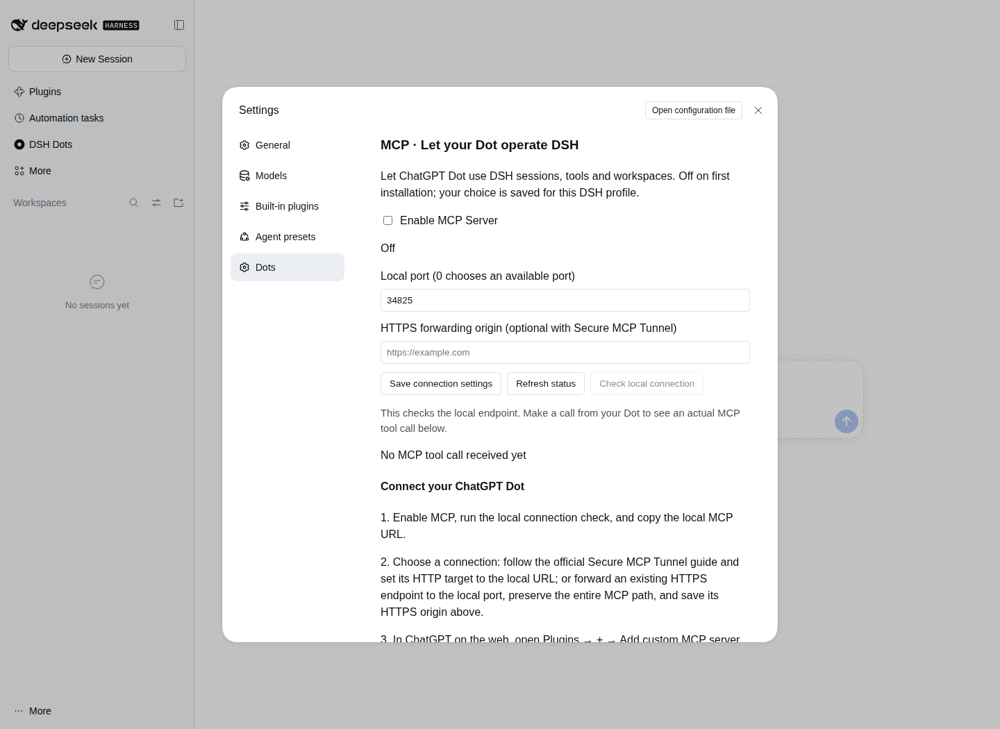
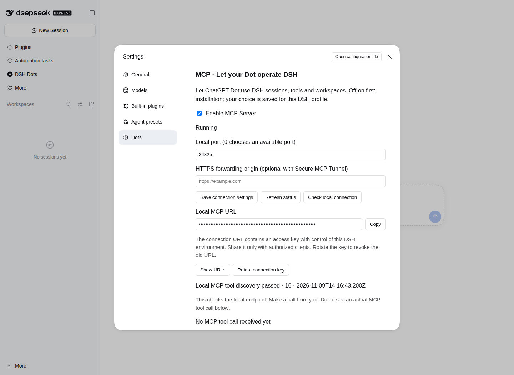
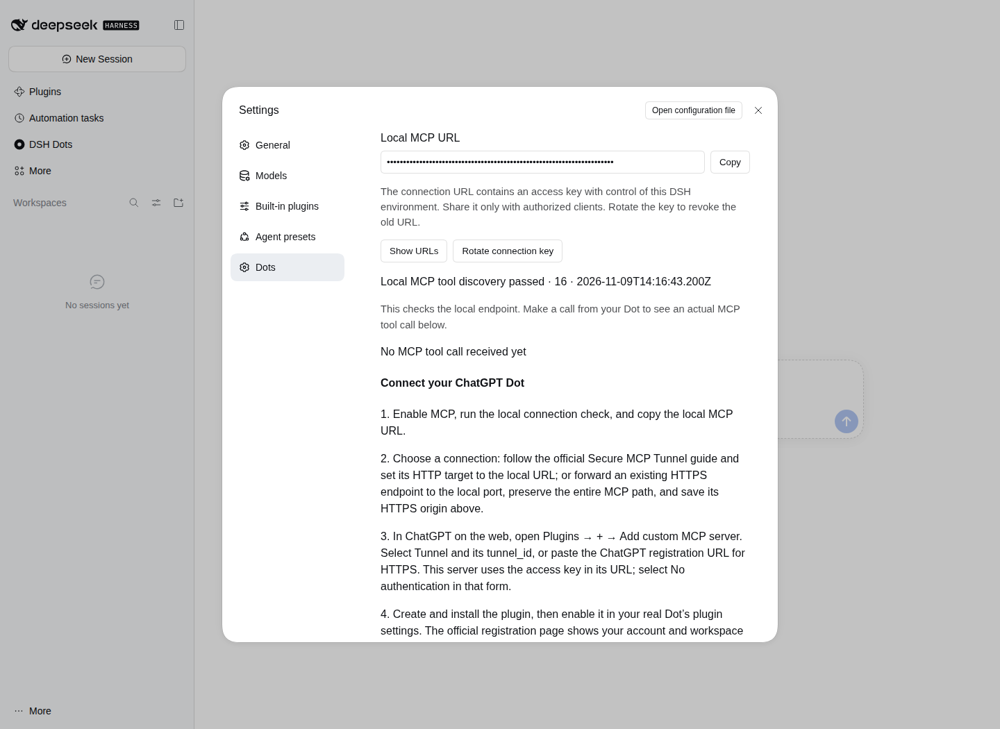

# DSH Dots 2.0.0: let your Dot use DSH

[Back to the project](../../README.en.md) · [中文](v2.0.0.md) · [Changelog](../../CHANGELOG.md)

2.0.0 development branch · Features and verification record

## What's new

Version 2.0.0 adds MCP connectivity to the existing Dots page. Your Dot can submit tasks to DSH, continue sessions, retrieve results, and work with files and tools in the current workspace.

MCP starts **off** and shares **DSH → Settings → Dots** with login retention. Once enabled, the page provides connection URLs, copy buttons, a local connection check, recent-call status and official registration guides. Settings persist across DSH restarts. Turning MCP off closes external access while DSH continues tasks already submitted.

This version also provides session model selection, image results, and access to the tools and plugin capabilities enabled in DSH. Preloading, retained pages across panel switches, themes, Chinese/English UI and Desktop login retention remain available.

## Connection compatibility and controls

Session parameters follow the current DSH interface, preserving native sequence cursors and extension fields. A prompt can contain both convenience text and structured content. Tool descriptions distinguish session creation, catalog inspection and execution.

MCP transports support large text and file requests, and HTTPS forwarding URLs can include a deployment path prefix. Connection diagnostics run independently of the service switch, so MCP can be turned off while a check is pending. The endpoint stays available while native DSH interfaces load or reload and reports the actual state of each capability.

Stored connection keys persist across restarts. “Rotate connection key” performs the requested change and revokes the previous URL. The default-off setting, saved preferences, Dots page and login retention remain available.

## Screenshots from the running application

These images were captured from **DSH Web 0.2.2-rc.1 running on Linux in Chromium**. Connection URLs remain masked in the UI.

### Off by default, enabled when needed

MCP and login retention share the Dots settings entry. A fresh installation starts with MCP off.

### Service status and connection details

Enabling MCP displays its running state, port, HTTPS forwarding settings and copyable connection URL. The local check reports the discovered tool count.

### Setup guidance in Settings

The same page contains the steps and official links for connecting the service, registering it in ChatGPT and enabling it for your Dot.

## Verification record

### 2026-11-10: bridge compatibility verification

Windows and Ubuntu each passed **99 tests**. Actual DSH and Chromium passed **26 native acceptance checks**, with **0** page errors. Coverage includes native negative cursors, a real file write above 5 MiB, large requests, batch messages and disabling the service while diagnostics are pending.

[Methods, results and new screenshot](../testing/v2.0.0-bridge.en.md) · [Verification data](v2.0.0/bridge-verification.json) · [CI record](https://github.com/Tests4gptplay/dsh-dots/actions/runs/42697875721)

### Initial feature baseline

Verification date: **2026-11-09**. These results describe the 2.0.0 functional baseline. Native checks ran after installing the actual plugin package in DSH.

| Environment and method | Coverage | Result |
| --- | --- | --- |
| Windows and Ubuntu automated tests | Existing webpage and login retention regressions, MCP and settings interaction | 71 passed on each platform |
| Windows and Ubuntu installation checks | npm / pnpm installation, compiled entry points and package contents | Passed |
| Linux / Node 24.22.2 / DSH Web 0.2.2-rc.1 | Official MCP client connected to actual DSH; sessions, files, images, cancellation, toggles and host restart | 20 native checks passed |
| Chromium using actual DSH Settings | Default off, enable/disable, local connection check, masked URLs, four official links and settings retained after reload | Passed; 0 page errors |

[Full CI record](https://github.com/Tests4gptplay/dsh-dots/actions/runs/42632878019) · [Verification summary](v2.0.0/verification.json)

### Native operations

| Operation | Observed result |
| --- | --- |
| Connect and discover capabilities | 16 MCP tools; the test profile exposed 144 DSH APIs, 30 namespaces and 31 session tools. |
| Create and query sessions | Newly created sessions were listed, and session records remained accessible after restarting DSH. |
| Write and read files | Files were saved in the actual workspace; contents on disk matched tool results. |
| Return an image | The file tool's image result was delivered as MCP image content. |
| Turn MCP off and on | Disabling released the endpoint; reenabling retained its URL and DSH sessions. |
| Restart DSH | Both enabled and disabled preferences persisted; an enabled service resumed with the host. |
| Cancellation and errors | DSH acknowledged cancellation and returned concrete errors for failed operations. |
| Host command-tool error | The test container's command sandbox returned `sandbox-unavailable`; MCP returned the corresponding host error. |

Capability counts describe the test profile. The available list follows the capabilities enabled in DSH.

## File-task experiment: create a report, then extend it

An interactive model test interface drove an actual DSH session. Model responses were supplied turn by turn; DSH executed the real file tools and returned file contents and session state.

The input was a three-row CSV:

| Item | Quantity | Unit price | Subtotal |
| --- | ---: | ---: | ---: |
| widget-A | 8 | 12 | 96 |
| widget-B | 6 | 40 | 240 |
| widget-C | 6 | 23 | 138 |

| Stage | Action | Result |
| --- | --- | --- |
| First turn: create the report | Read the CSV, calculate subtotals and the total, save `report.txt`, then read it back. | Subtotals: 96, 240, 138. Grand total: **474**, saved and verified by reading the file. |
| Second turn: continue the same session | Read the report, add the total quantity, save and read it back. MCP was turned off during execution. | Total quantity: **20**. Grand total remained **474**. The task completed and its result was retrieved after MCP was reenabled. |
| Cancel during execution | Send a cancellation while a model request is running. | DSH accepted the cancellation and the session returned from running to idle. |

[Input CSV](v2.0.0/input.csv) · [Final report](v2.0.0/report.txt) · [Experiment record](v2.0.0/experiments.json)

The recorded scope covers local MCP, actual DSH Web, browser settings and model-driven file tasks. Official Dot registration, phone-to-home access and Windows/macOS Desktop login retention belong to account- and device-level acceptance.

## Get started

See the [project introduction](../../README.en.md) for installation and connection steps. Settings also links to the [official MCP registration guide](https://developers.openai.com/plugins/deploy/connect-chatgpt), [Secure MCP Tunnel guide](https://developers.openai.com/api/docs/guides/secure-mcp-tunnels) and [Dot plugin settings](https://help.openai.com/en/articles/20001530-getting-started-with-your-dot).

Report problems under [Issues](https://github.com/Tests4gptplay/dsh-dots/issues).
