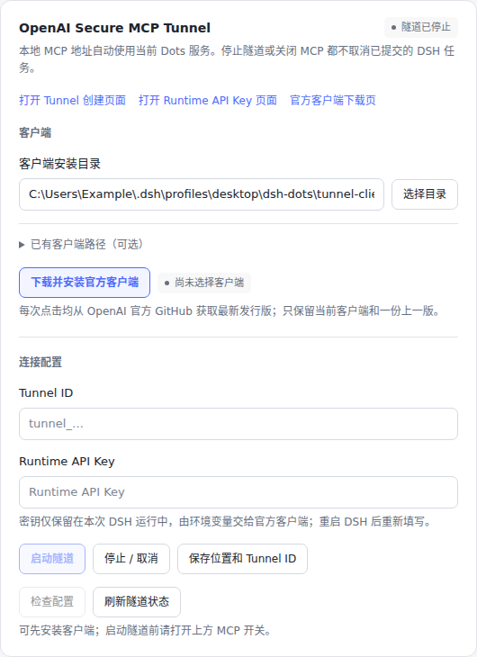
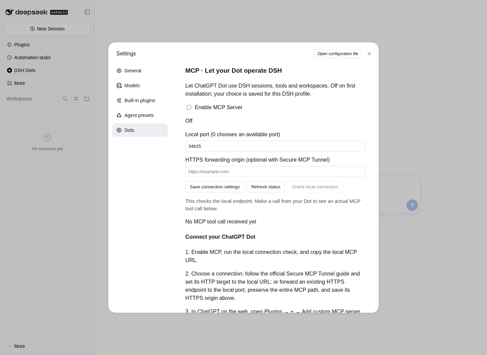
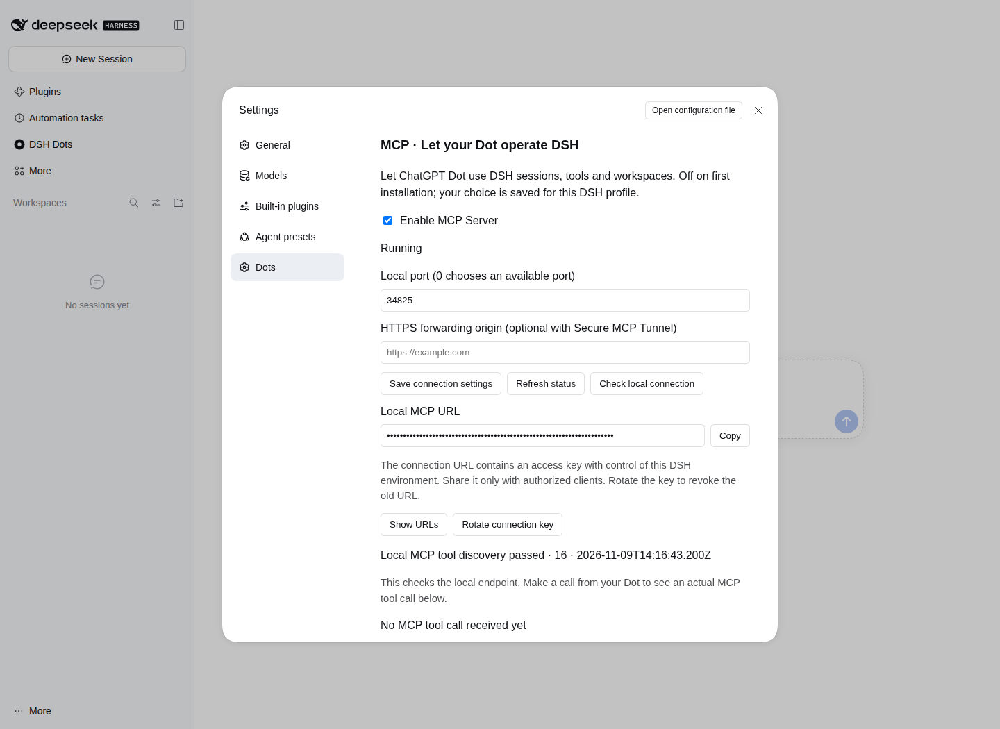
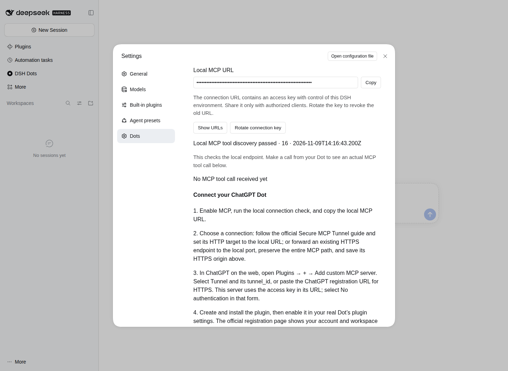

# DSH Dots 2.0.0：让 Dot 调用 DSH

[返回项目介绍](../../README.md) · [English](v2.0.0.en.md) · [全部更新记录](../../CHANGELOG.md)

2.0.0 正式发行 · 功能与验证记录

## 2.0.0 正式版功能与验收（2026-11-14）

本正式版基于已验收的 `2.0.1-test.9` 功能与界面，统一版本号为 `2.0.0`。在 DeepSeek Harness 中使用 ChatGPT Dot，并通过 MCP 让 Dot 操作 DSH 会话、任务、工具和工作区，包含 17 个 MCP 工具入口、请求内事件流、按指定 Session 的主动通知和官方 Secure MCP Tunnel 管理。

网页工具栏增加“后退”，点击 Dots 图标或名称可直接返回 Dot 首页；页面和登录分区持续保留。设置页沿用已确认的卡片布局及中英文、明暗主题样式，完整五步连接指南位于 MCP、Tunnel、主动通知区域下方，可折叠查看。隧道启动／停止选择及其运行密钥保存在当前 DSH 用户配置中，重启后自动恢复此前启用的隧道。

正式版复用测试版验证的功能路径：Windows / Linux 各 142 项源码回归通过、Chromium 16 组 UI 布局检查通过；实际 Linux DSH 0.2.2-rc.1 加载候选包执行 31 项原生验收通过。隧道启停记忆专项使用受控客户端进程验证重启自动恢复和手动停止后保持关闭。另有历史阶段的 DSH 工作区文件读写与会话继续实验，记录见本页下方。

[2.0.1-test.9 候选版验收及来源](v2.0.1-test.9.md) · [机器可读验收结果](v2.0.1-test.9/verification.json) · [GitHub Actions 验收记录](https://github.com/Tests4gptplay/dsh-dots/actions/runs/43588447901)

### 最终设置页视觉

以下图片由同一 UI 设计阶段的生产 React Client 在 Chromium 中渲染，展示正式版保留的设置页样式：

## 本次更新

2.0.0 在原有 Dots 网页入口上加入 MCP 连接。Dot 可以向 DSH 提交任务、继续会话、查看结果，并使用当前工作区中的文件和工具。

MCP 首次安装默认关闭，与登录保持一起放在 **DSH → 设置 → Dots**。开启后，页面提供连接地址、复制按钮、本地连接检查、最近调用和官方注册指南。设置会保存，重启 DSH 后恢复。关闭 MCP 结束外部接入，已提交的任务继续由 DSH 执行。

这一版还支持会话中的模型查询与选择、图片结果返回，以及调用 DSH 当前启用的工具和插件能力。原有预加载、切换页面保留、主题适配、中英文界面和 Desktop 登录保持继续保留。

## 连接兼容与操作体验改进

会话参数与当前 DSH 接口直接对接，保留原生序列游标和扩展字段；输入指令时可以同时传入文本与结构化内容。工具说明区分会话创建、目录查询和执行操作。

MCP 传输支持大文本与文件请求，HTTPS 转发地址支持部署路径前缀。运行中的连接检查与服务开关独立，检查期间仍可关闭 MCP；DSH 原生接口加载或重载时，MCP 连接入口保持可用，并返回对应能力的实际状态。

连接密钥在重启后沿用原值；点击“更换连接密钥”执行更换，旧地址随即失效。原有默认关闭、设置保存、网页与登录保持功能继续保留。

### 2026-11-10：连接状态与图片回传优化

关闭 MCP 时及时停止本机连接；若设置保存遇到文件系统错误，界面显示实际关闭状态及保存结果。连接检查状态与开关保持同步。图片数据经 MCP 图片内容返回，保留 DSH 的附件及工具结果信息；同时完善 Desktop 网页资源释放异常的处理。

本项包含配置保存失败、图片数据、连接检查和浏览器释放路径的定向回归测试；现有网页、登录保持和工具使用方式维持不变。Linux / Node 22 的 **104 项源码回归通过**；Linux / Node 24、真实 DSH 0.2.2-rc.1 安装候选包后的 **25 项原生操作验证通过**。完整输入及测试条件见 [本轮结构化验证数据](v2.0.0/lifecycle-verification.json)，专项测试见 `tests/mcp-lifecycle-fixes.test.mjs`。

## 实机界面

以下图片来自 **Linux 上实际运行的 DSH Web 0.2.2-rc.1 与 Chromium**。连接地址在界面中保持遮罩显示。

### 默认关闭，按需开启

MCP 与登录保持使用同一 Dots 设置入口；首次安装保持关闭。

### 服务与连接信息

启用后显示运行状态、端口、HTTPS 转发设置和可复制的连接地址。本地检查会显示发现的工具数量。

### 从设置页完成接入

同一页面提供接入步骤与官方指南入口，帮助完成服务连接、ChatGPT 注册和 Dot 插件启用。新版 ChatGPT 在 **Plugins → ＋ / Add → Add custom MCP server** 创建连接，确认官方提示后点击 **Create as a plugin**，随后在个人 Plugins 中安装，再在 Dot 的 **Customize → Plugins** 中使用该共享连接。

## 验证记录

### 2026-11-10：连接兼容性复检

Windows、Ubuntu 各 **99 项测试通过**；实际 DSH 与 Chromium 共 **26 项原生验收通过**，页面异常为 **0**。覆盖原生负游标、超过 5 MiB 的真实文件写入、较大请求与批量消息，以及连接检查进行中关闭服务。

[完整方法、结果与新增实机截图](../testing/v2.0.0-bridge.md) · [验证数据](v2.0.0/bridge-verification.json) · [CI 记录](https://github.com/Tests4gptplay/dsh-dots/actions/runs/42697875721)

### 初版功能基线

验证日期：**2026-11-09**。下表对应 2.0.0 功能基线，测试安装包实际安装到 DSH 后执行。

| 环境与方法 | 覆盖内容 | 结果 |
| --- | --- | --- |
| Windows、Ubuntu 自动化测试 | 既有网页与登录保持回归、MCP 和设置交互 | 每个平台 71 项通过 |
| Windows、Ubuntu 安装检查 | npm / pnpm 安装、预编译入口及包内文件检查 | 通过 |
| Linux / Node 24.22.2 / DSH Web 0.2.2-rc.1 | 官方 MCP 客户端连接实际 DSH；会话、文件、图片、取消、开关及重启恢复 | 20 项原生验收通过 |
| Chromium 操作实际 DSH 设置页 | 默认关闭、启停、本地连接检查、地址遮罩、4 个官方链接、刷新后设置保留 | 通过，页面异常 0 |

[查看本次完整 CI 记录](https://github.com/Tests4gptplay/dsh-dots/actions/runs/42632878019) · [下载验证摘要](v2.0.0/verification.json)

### 原生操作覆盖

| 操作 | 观察到的结果 |
| --- | --- |
| 连接并发现能力 | 找到 16 个 MCP 工具入口；测试配置中可发现 144 个 DSH API、30 个命名空间和 31 个会话工具。 |
| 创建、查询会话 | 新会话可查询；重启 DSH 后，会话记录仍可读取。 |
| 写入与读回文件 | 文件实际保存到工作区；磁盘内容与工具返回的内容一致。 |
| 返回图片 | 文件工具返回的图片以 MCP 图片内容传回客户端。 |
| 关闭再开启 MCP | 关闭时释放连接入口；重新开启后保留连接地址和 DSH 会话。 |
| 重启 DSH | 开启和关闭两种选择分别保存；开启状态可随宿主恢复。 |
| 取消与错误信息 | 取消操作得到宿主确认；错误按实际原因返回。 |
| 命令工具的宿主错误 | 该测试容器的命令沙箱返回 `sandbox-unavailable`，MCP 返回对应宿主错误。 |

工具数量是上述测试配置的观测值，实际列表随 DSH 启用的能力变化。

## 文件任务实验：生成报告，再继续补充

实验使用交互式模型测试接口驱动真实 DSH 会话。模型输出按轮次送入宿主，由 DSH 执行实际文件工具，并返回文件内容与会话状态。

输入是一份三行 CSV：

| 项目 | 数量 | 单价 | 小计 |
| --- | ---: | ---: | ---: |
| widget-A | 8 | 12 | 96 |
| widget-B | 6 | 40 | 240 |
| widget-C | 6 | 23 | 138 |

| 实验阶段 | 操作 | 结果 |
| --- | --- | --- |
| 第一轮：生成报告 | 读取 CSV，计算小计和总额，保存 `report.txt`，再读回核对。 | 小计 96、240、138；总额 **474**，已保存并读回。 |
| 第二轮：继续同一会话 | 读取报告，补充数量合计，再保存并读回。执行期间关闭 MCP。 | 数量合计 **20**；总额仍为 **474**。任务继续完成，重新开启 MCP 后取得结果。 |
| 执行中取消 | 在一次模型请求运行时发出取消操作。 | DSH 接受取消，会话从运行状态回到空闲状态。 |

[实验输入 CSV](v2.0.0/input.csv) · [最终报告](v2.0.0/report.txt) · [实验记录](v2.0.0/experiments.json)

本页验证范围为本地 MCP、实际 DSH Web、浏览器设置与模型驱动的文件任务。官方 Dot 账户注册、手机远程连接及 Windows/macOS Desktop 登录保持属于账户和设备验收范围。

## 开始使用

安装与连接步骤见 [项目介绍](../../README.md)。设置页也提供 [官方 MCP 注册指南](https://help.openai.com/zh-hans-cn/articles/12584461-connecting-custom-mcp-servers-in-chatgpt)、[Secure MCP Tunnel 指南](https://developers.openai.com/api/docs/guides/secure-mcp-tunnels) 和 [Dot 插件设置说明](https://help.openai.com/en/articles/20001530-getting-started-with-your-dot)。

反馈问题请使用 [Issues](https://github.com/Tests4gptplay/dsh-dots/issues)。
