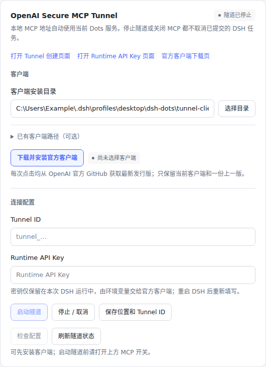
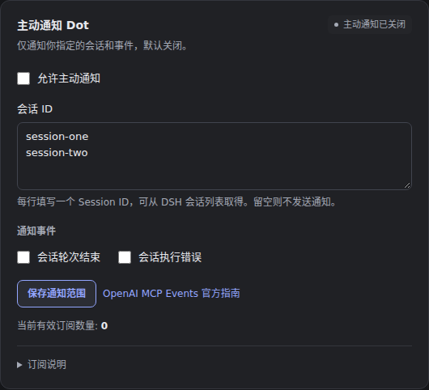

# DSH Dots 2.0.1-test.8：设置页布局更新

[返回项目介绍](../../README.md) · [上一测试版](v2.0.1-test.7.md)

## 界面调整

MCP 连接、官方隧道和主动通知使用统一的卡片分组。正文与字段采用 13px，标题 14px，说明 12px；主操作、状态和辅助链接分层展示。

MCP 开关、主动通知开关及两个通知事件选项采用固定 16px 勾选框，位于标签左侧并垂直对齐。点击标签文字或使用键盘空格均可切换。路径输入与「选择目录」在有空间时同排；窄面板中按可用宽度自然换行。

客户端安装与隧道连接操作分组展示。已有客户端路径、接入指南、订阅说明和诊断可展开查看；原有字段和操作全部保留。颜色沿用 DSH 明暗主题变量。

## 界面预览

以下截图加载候选包的实际 React Client，在 Chromium 中以测试数据渲染；会话 ID 和路径均为示例值。

### 主动通知


### 官方隧道



### 深色主题



## 安装

在 DSH 插件添加框填写：

```text
github:Tests4gptplay/dsh-dots#2.0.1-test.8
```

## 验证结果

2026 年 11 月 14 日完成本轮验收，使用最终候选 TGZ 加载生产运行文件。

| 环境与项目 | 结果 |
| --- | --- |
| Windows Server 2025 / Node 24.22.2 源码回归 | 141 项通过、0 失败、1 项条件跳过 |
| Ubuntu 26.04 / Node 24.22.2 源码回归 | 141 项通过、0 失败、1 项条件跳过 |
| Chromium 组件布局 | 中文、英文 × 明暗主题 × 320 / 360 / 530 / 760px，共 16 组通过 |
| 真实 DSH 0.2.2-rc.1 / Linux 原生宿主 | 31 项通过，包含实际 Chromium 设置页操作 |
| 原生页面控件测量 | 四处勾选框均为 16 × 16px，文字间距 9px，垂直中心偏差 0px |
| 原生页面宽度 | 900px、1280px 视口无横向溢出 |
| 最终安装包 | 20 个生产文件，解包、语法与清单检查通过 |

组件布局测试包含点击标签、键盘空格切换、表单保存和目录按钮对齐；实际 DSH 页面检查启停、连接检查、地址隐藏、诊断期间关闭与设置恢复。条件跳过项为需另行准备官方 Tunnel Client 二进制的独立执行测试；本轮调整的是界面，未重复运行该项。

[完整 GitHub Actions 记录](https://github.com/Tests4gptplay/dsh-dots/actions/runs/43582823162) 中的 `dots-ui-Linux-evidence` 保存实际 DSH 截图、布局测量、浏览器报告、宿主报告及候选包。[机器可读验收摘要](v2.0.1-test.8/verification.json)记录环境与包校验值。

本版改动集中于设置页显示、样式与交互布局。MCP 接口、通知范围、开关默认值、官方隧道管理和既有任务执行保持原有行为。
