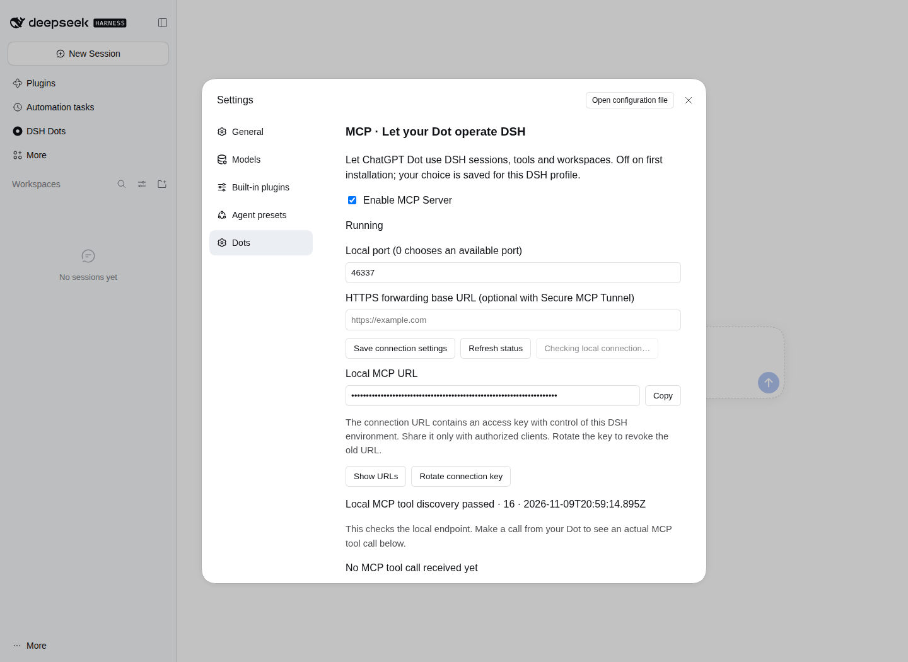

# DSH Dots 2.0.0: bridge compatibility verification

[Release notes](../releases/v2.0.0.en.md) · [中文](v2.0.0-bridge.md)

## Environment and results

The candidate package was installed in DSH 0.2.2-rc.1 on Linux with Node 24.22.2. Windows and Ubuntu each passed all 99 source and regression tests, compiled-output checks, and npm/pnpm installation checks. The actual DSH and Chromium acceptance suite passed 26 checks with no browser page errors. Linux Node 22.16.0 also passed all 99 source and regression tests.

[CI run](https://github.com/Tests4gptplay/dsh-dots/actions/runs/42697875721) · [Structured results](../releases/v2.0.0/bridge-verification.json)

## Session and file operations

Native `afterSeq: -1` and `throughSeq: -1` calls completed successfully. Session extension fields and combined text/content blocks were forwarded intact. A 5,242,899-byte file was written through the native DSH file tool and verified byte for byte on disk. Session creation, discovery, cancellation, text/image results, service toggles and full host restart checks also passed.

## Transport checks

The packaged HTTP service accepted JSON bodies of 4 MiB + 1 byte, 5 MiB and 16 MiB. The web-standard handler and the 2026-07-28 protocol were also tested with 5 MiB bodies. Legacy batches of 101 and 256 messages returned all corresponding results. The modern protocol accepted 1,025 subscriptions and closed them successfully. Text results larger than 5 MiB were preserved.

These transport tests use controlled native API responses to inspect arguments and protocol behavior; the file and session operations above run against actual DSH. The listed sizes are test inputs, not product limits.

## Settings and service lifecycle

Diagnostics can remain pending while the service is disabled, suspended or unloaded. API loading and recovery do not require restarting the MCP listener. HTTPS deployment prefixes and existing connection keys were retained correctly.

This screenshot shows actual DSH Settings in Chromium while a diagnostic is pending. The service switch remains available; the browser test then disables the service and confirms that the disabled preference survives a page reload. Connection URLs remain masked.



## Reproduce

```sh
npm ci --legacy-peer-deps
npm test
npm run pack:check
npm pack --ignore-scripts
```

`tests/native/verify.mjs` installs and tests the candidate in an isolated real DSH profile. Set `DSH_BROWSER_TEST=1` to include Chromium Settings acceptance. Build artifacts include the package, source, screenshots, test records and SHA-256 checksums.
