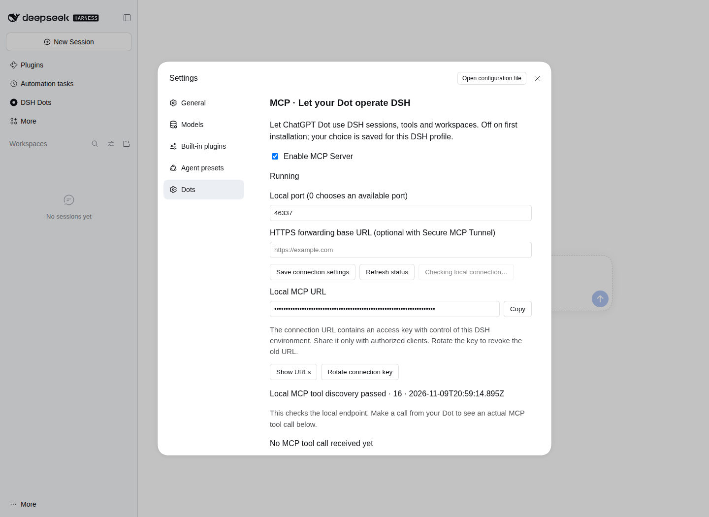

# DSH Dots 2.0.0：连接与参数兼容性验证

[返回更新记录](../releases/v2.0.0.md) · [English](v2.0.0-bridge.en.md)

本页记录 MCP 连接、原生会话参数、较大请求和服务启停的验证。测试使用 2.0.0 候选安装包；文件内容、会话状态和执行结果由实际 DSH 读取及写入。

## 验证环境

- Linux，Node 22.16.0 与 24.22.2。
- 真实 DSH 0.2.2-rc.1，独立 profile 和工作区，安装候选 TGZ。
- MCP TypeScript SDK 2.4.0，Node 传输适配 2.1.2。
- 运行实现提交：`8e7e917f4924275ca3f6ebffe86cb669f2947fd9`。

## 会话与文件操作

| 操作 | 结果 |
| --- | --- |
| 使用 `afterSeq: -1` 等待会话事件 | 原生接口正常返回 |
| 使用 `throughSeq: -1` 读取历史切点 | 原生接口正常返回 |
| 传递原生会话扩展字段、同时提供文本和内容块 | 参数保持完整并传给 DSH |
| 写入 5,242,899 字节文件 | 写入成功；读回文件逐字节一致 |
| 创建、查询、取消会话，读取文本及图片 | 原生调用通过 |
| 关闭、重新开启及重启宿主 | 开关选择、连接地址和会话按原有规则恢复 |

大文件 SHA-256：`aa5da7eada66dab13d5e9cb3b078b2a064cfeb2e7c7a9b0e1a9651883e65876e`。

## 传输与操作回归

以下项目使用安装包中的实际 MCP HTTP 服务；受控宿主接口用于核对参数是否完整到达执行入口。

| 输入或场景 | 结果 |
| --- | --- |
| 完整请求体为 4 MiB + 1 字节、5 MiB、16 MiB | 正常处理 |
| Web 标准 handler 直接接收 5 MiB 请求 | 正常处理 |
| 2026-07-28 协议接收 5 MiB 请求 | 正常处理 |
| 旧版 JSON-RPC 批量请求为 101 条、256 条 | 所有请求返回对应结果 |
| 2026-07-28 协议建立 1,025 个订阅 | 建立及关闭成功 |
| 返回超过 5 MiB 的文本结果 | 内容完整 |
| 连接检查暂未返回时关闭、暂停或卸载 | 立即进入对应操作，诊断被取消 |
| 原生 API 加载或恢复 | MCP 连接继续可用，工具调用读取宿主当前能力 |
| HTTPS 转发地址带路径前缀 | 地址生成与请求路由一致 |
| 保存的有效连接密钥采用不同长度 | 重载后保持原值 |

表中数据量是本次测试输入，不是插件的产品上限。数值和内容参数由原生 DSH 接口处理，MCP 协议结构继续由官方 SDK 解析。

新增的同组 27 项连接与界面回归全部通过；完整源码与回归测试为 99 项，Windows 与 Ubuntu 各通过 99 项，另在 Linux Node 22 和 Node 24 复测通过。真实 DSH 与 Chromium 共通过 26 项原生验收，浏览器页面异常为 0。

[完整 CI](https://github.com/Tests4gptplay/dsh-dots/actions/runs/42697875721) · [结构化验证记录](../releases/v2.0.0/bridge-verification.json)

### 连接检查期间仍可操作服务开关

下图来自实际 DSH Web 与 Chromium：本地诊断暂未返回时，启用开关仍可操作。浏览器验收随后关闭服务，并核对刷新后仍保持关闭。连接地址在界面中保持遮罩。



## 可复现测试

```sh
npm ci --legacy-peer-deps
npm test
npm run pack:check
npm pack --ignore-scripts
```

`tests/mcp-bridge.test.mjs` 覆盖参数、请求大小、批量消息、协议订阅、错误返回与启停。`tests/mcp-settings.test.mjs` 覆盖设置页交互。`tests/native/verify.mjs` 在真实 DSH profile 中安装并测试候选包；设置 `DSH_BROWSER_TEST=1` 同时执行 Chromium 设置页验收。

持续集成在 Windows 和 Ubuntu 上执行构建、回归及 npm/pnpm 安装检查；Ubuntu 还运行真实 DSH 与 Chromium。每次构建产物附带源码、安装包、运行记录及 SHA-256 校验值。
